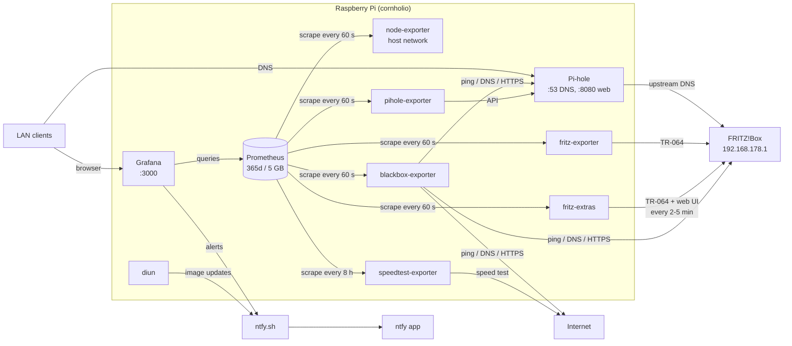
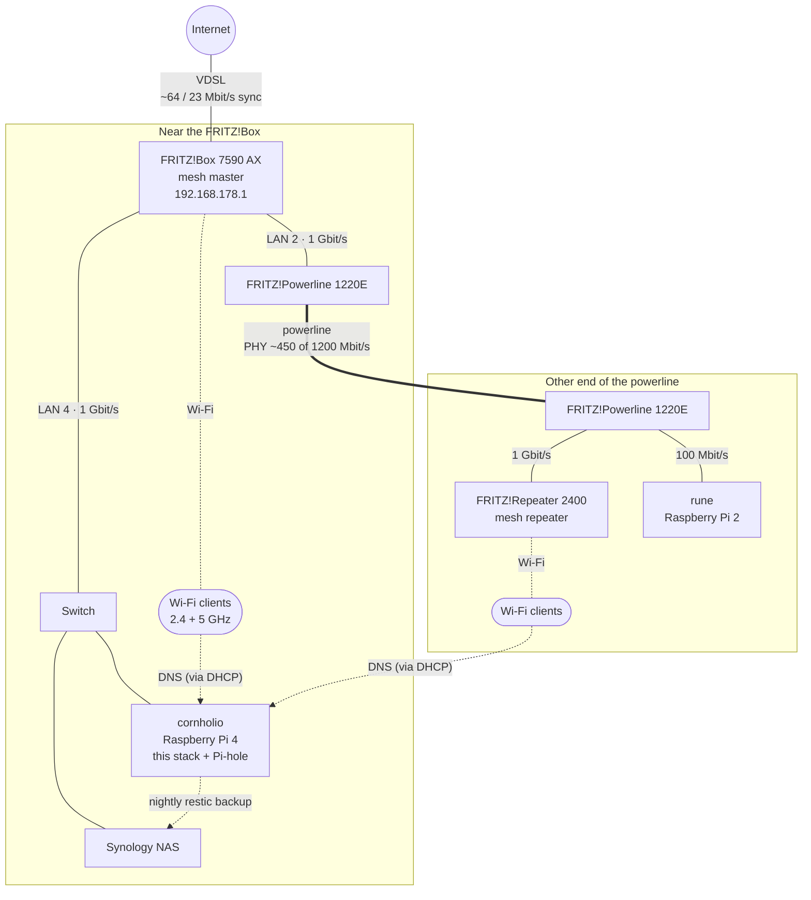

# FRITZ!Box monitoring and Pi-hole on a Raspberry Pi

A Docker Compose stack on a Raspberry Pi that:

- **monitors the FRITZ!Box** (bandwidth, connection, DSL/cable stats, CPU temperature/load, RAM, which
  devices are online) and shows it in Grafana,
- **monitors the Pi itself** (CPU temperature, load, RAM, SSD, network),
- **measures internet quality** from inside the LAN (ping, DNS, HTTPS) and runs a speed test every 8 h
  (see [Speed test](#speed-test)),
- **blocks ads and trackers** for the whole LAN with Pi-hole,
- **sends push notifications** to your phone (ntfy) when something breaks, and weekly when image
  updates are available,
- **backs itself up** nightly to the Synology NAS (restic).

All data lives on the Pi's USB SSD.

## Architecture



| Service | Image | Purpose | Reachable at |
|---|---|---|---|
| `fritz-exporter` | `pdreker/fritz_exporter:3` | Reads FRITZ!Box metrics via TR-064 | internal only |
| `fritz-extras` | `python:3.13-alpine` + `fritz-extras/fritz_extras.py` | Our add-on: online devices by name, CPU temperature/load, RAM, energy use, mesh backhaul path (see [below](#fritz-extras-devices-and-system-values)) | internal only |
| `node-exporter` | `prom/node-exporter:v1` | Health of the Pi | `172.17.0.1:9100` (Docker-internal, not the LAN) |
| `blackbox-exporter` | `prom/blackbox-exporter:v0.29.0` | Ping, DNS and HTTPS probes | internal only |
| `prometheus` | `prom/prometheus:v3` | Stores all metrics (365 days or 5 GB) | internal only |
| `grafana` | `grafana/grafana:13.1` | Dashboards and alerting | `http://<pi-ip>:3000` |
| `pihole` | `pihole/pihole:2026.09.0` | DNS ad blocker for the LAN | DNS `<pi-ip>:53`, web `http://<pi-ip>:8080/admin` |
| `pihole-exporter` | `ekofr/pihole-exporter:v1.2.0` | Pi-hole statistics for Prometheus | internal only |
| `speedtest-exporter` | `miguelndecarvalho/speedtest-exporter:v3.5.4` | Ookla speed test, one per scrape (every 8 h) | internal only |
| `diun` | `crazymax/diun:4` | Weekly check for new image versions → ntfy | internal only |

Images are pinned (major version, or exact version for pre-1.0 and Pi-hole) so updates only happen
when you change a tag. Diun tells you when there's something new.

## Network

The physical home network as the FRITZ!Box mesh overview showed it on 2026-10-13. Only infrastructure is
named; phones, laptops and other clients come and go and are left out (see the **Devices** section of
the FRITZ!Box dashboard for them).



- **Backhaul:** the repeater is connected through the powerline adapters, not over Wi-Fi. That's why
  `fritz_exporter`'s `fritz_mesh_*` metrics are empty and the mesh panels use fritz-extras
  (`fritz_extras_mesh_*`), which follows the path through the adapters.
- **Powerline rate:** the ~450 Mbit/s is the PHY rate the adapters negotiate and it varies with the
  mains; the real throughput is roughly half. The FRITZ!Box dashboard shows it over time
  (**Mesh link rate history**).
- **Switch:** port 4 serves several devices (cornholio, the NAS and others), so there is a switch;
  the FRITZ!Box can't see it, only the devices behind it.
- **rune** (Raspberry Pi 2) is on the second port of the far powerline adapter. Its 100 Mbit/s
  Ethernet is why it isn't used for a powerline throughput test (see `ROADMAP.md`).
- **DNS:** every client gets cornholio (Pi-hole) as DNS server from the FRITZ!Box DHCP; Pi-hole asks
  the FRITZ!Box upstream.

## Files

| Path | Content |
|---|---|
| `docker-compose.yml` | All services, volumes, log rotation |
| `fritz-extras/fritz_extras.py` | The fritz-extras add-on (Python standard library only) |
| `prometheus/prometheus.yml` | Scrape targets: FRITZ!Box (exporter + fritz-extras), Pi, Pi-hole, speed test (every 8 h), blackbox probes |
| `blackbox/blackbox.yml` | Probe modules: `icmp`, `dns_example`, `http_2xx` |
| `grafana/provisioning/datasources/` | Prometheus data source (uid `prometheus`) |
| `grafana/provisioning/alerting/` | Alert rules, ntfy contact point, notification policy |
| `grafana/provisioning/dashboards/` | Provisioned dashboards (`json/cornholio.json`, `json/fritzbox.json`, `json/speedtest.json`), folder **cornholio** in Grafana |
| `grafana/generators/` | Python scripts that generate those dashboard JSON files |
| `backup/` | restic backup script and systemd service/timer |
| `*.env.example` | Templates for the secret env files (see below) |
| `ROADMAP.md` | Planned extensions, ticked off as they're done |
| `FRITZ-METRICS.md` | What the FRITZ!Box exporter delivers, and how other dashboards' metrics map to it |
| `REINSTALL-PI.md` | How the Pi was reinstalled (OS on the USB SSD, bootloader recovery) |
| `CLAUDE.md` | Context and rules for Claude Code |

### Secret env files (git-ignored, never commit or share)

| File | Variables | Used by |
|---|---|---|
| `fritz.env` | `FRITZ_HOSTNAME`, `FRITZ_USERNAME`, `FRITZ_PASSWORD` (max. 32 chars), `FRITZ_HOST_INFO` (off), `FRITZ_WIFI_CLIENT_INFO` (on), `DEVICE_ALLOWLIST` (empty = name all devices) | fritz-exporter, fritz-extras |
| `pihole.env` | `FTLCONF_webserver_api_password` (in single quotes) | Pi-hole web login |
| `pihole-exporter.env` | `PIHOLE_PASSWORD`: a Pi-hole **app password** (Settings → Web interface / API → Expert → Configure app password), not the login password | pihole-exporter |
| `grafana.env` | `NTFY_TOPIC` (long random name; whoever knows it can read your alerts) | Grafana alerts, Diun |

Create each with `cp X.env.example X.env && chmod 600 X.env`, then fill it in.

## Setup

### 1. FRITZ!Box
- **System → FRITZ!Box Users → Add User**: e.g. `monitoring`, password **max. 32 characters**,
  permission **"FRITZ!Box Settings"**.
- **Home Network → Network → Network Settings**: enable **"Allow access for applications"**.
- **Home Network → Network**: give the Pi a fixed IPv4 address ("Always assign this network device
  the same IPv4 address").

### 2. Raspberry Pi OS on the SSD
Use **Raspberry Pi OS Lite (64-bit)**. Then make sure Docker's data ends up on the SSD:

**A) Pi boots from the SSD** (recommended, current setup): nothing to do. See `REINSTALL-PI.md` for
flashing the SSD with Raspberry Pi Imager.

**B) Pi boots from an SD card, SSD is extra storage:**
```bash
# mount the SSD permanently (ext4 recommended)
lsblk -f                                   # find the SSD's UUID
sudo mkdir -p /mnt/ssd
echo 'UUID=<your-uuid> /mnt/ssd ext4 defaults,noatime 0 2' | sudo tee -a /etc/fstab
sudo mount -a

# install Docker, then move its data to the SSD
curl -fsSL https://get.docker.com | sh
sudo systemctl stop docker docker.socket
echo '{ "data-root": "/mnt/ssd/docker" }' | sudo tee /etc/docker/daemon.json
sudo mkdir -p /etc/systemd/system/docker.service.d
printf '[Unit]\nRequiresMountsFor=/mnt/ssd\n' | sudo tee /etc/systemd/system/docker.service.d/ssd.conf
sudo systemctl daemon-reload && sudo systemctl start docker
docker info | grep "Docker Root Dir"       # should show /mnt/ssd/docker
```
`RequiresMountsFor` makes Docker wait for the SSD at boot, so it never writes to the SD card by mistake.

### 3. Docker
```bash
curl -fsSL https://get.docker.com | sudo sh   # case A; already done in case B
sudo usermod -aG docker $USER                  # then log out and back in
```

### 4. Copy the project and fill in the env files
From the machine with this folder (excluding private files). `cornholio` is the SSH host alias for the
Pi; how SSH access is set up (Secretive key) is described in `REINSTALL-PI.md`.
```bash
rsync -a --exclude '*.env' --exclude .claude --exclude .git ./ cornholio:fritz-monitoring/
```
On the Pi:
```bash
cd ~/fritz-monitoring
for f in fritz pihole pihole-exporter grafana; do [ -e $f.env ] || install -m 600 $f.env.example $f.env; done
nano fritz.env      # FRITZ!Box user and password
nano pihole.env     # Pi-hole web password, in single quotes
nano pihole-exporter.env   # Pi-hole app password (create it after Pi-hole's first start)
echo "NTFY_TOPIC=cornholio-$(tr -dc a-z0-9 </dev/urandom | head -c 24)" > grafana.env
```

### 5. Start
```bash
docker compose up -d
docker compose ps                         # all running, pihole "healthy"
docker compose logs -f fritz-exporter     # "Exporter is ready", no 401 errors
```

## Using it

### Grafana: `http://<pi-ip>:3000`
First login: `admin` / `change-me-on-first-login`; Grafana asks for a new password. This value only
applies on the very first start, after that the password lives in the `grafana-data` volume.

Three dashboards are built in (folder **cornholio**, read-only in the UI):
- **cornholio** (`/d/cornholio-stack`): the stack itself: backups (last success, duration, snapshots,
  repository size, backed-up data, new data per run), scrape targets up/down, fritz-extras, and the
  Pi's temperature, SSD, RAM, load and uptime.
- **FRITZ!Box** (`/d/cornholio-fritzbox`): every metric the FRITZ!Box delivers (explained in
  [FRITZ!Box datapoints](#fritzbox-datapoints)), in sections Status,
  Internet traffic (incl. sync rate and speed tests as reference, daily volume of the last 30 days, the last
  24 h compared with the day before and a week ago), DSL line, Wi-Fi and mesh (incl.
  signal and link speed per Wi-Fi client), Connections and provider, FRITZ!Box system (CPU temperature,
  load, RAM, energy) and Devices (online now and history, from [fritz-extras](#fritz-extras-devices-and-system-values)), LAN and exporter.
- **Speedtest** (`/d/cornholio-speedtest`), see [Speed test](#speed-test).

To change one, edit its script in `grafana/generators/`, run it (`python3 grafana/generators/fritzbox.py`
from the project folder), copy to the Pi; Grafana reloads within a minute. Import the others via
**Dashboards → New → Import**, data source **Prometheus**:

| ID | Dashboard | Shows |
|---|---|---|
| **13983** | Fritz!Exporter | Bandwidth, connection, uptime |
| **17751** | Fritz!Exporter Dash | DSL line quality (attenuation, noise margin, CRC/FEC errors), PPP uptime, Wi-Fi clients, firmware updates |
| **1860** | Node Exporter Full | The Pi: CPU, temperature, RAM, SSD, network |
| **7587** | Prometheus Blackbox Exporter | Ping latency/loss, DNS time, HTTPS checks |
| **10176** | Pi-hole Exporter | Queries, block rate, top domains/clients, upstream response time |

Both FRITZ!Box dashboards work with `FRITZ_HOST_INFO=false`. Only 17751's per-device panels
(`fritz_host_active`) stay empty. Turning it on (`fritz.env`) makes each scrape take 20+ s instead of
~5 s and loads the router; then raise `scrape_timeout` for the fritz-exporter job to ~45s.

### Pi-hole: `http://<pi-ip>:8080/admin`
To use it for the whole LAN, on the FRITZ!Box: **Home Network → Network → Network Settings →
IPv4 Settings → Local DNS server** = the Pi's IP.

- Clients switch when their DHCP lease renews (FRITZ!Box default: 10 days). To switch now:
  Mac: System Settings → Network → connection → Details → TCP/IP → **Renew DHCP Lease**;
  iPhone: turn Wi-Fi off and on in Settings (or forget and rejoin the network);
  Android: turn Wi-Fi off and on, and set **Private DNS** to Off or Automatic.
- Check on a Mac: `scutil --dns | grep nameserver` shows the Pi's IP.
- **Don't** enter the Pi as the FRITZ!Box's own upstream DNS (Internet → Account Information →
  DNS Server). Pi-hole forwards to the FRITZ!Box, so that would create a loop.
- Pi-hole blocks `mask.icloud.com`, so Apple devices turn off iCloud Private Relay on this network
  and Safari is filtered too. Private Relay stays active on other networks.
- If you enable IPv6 in the LAN, also set the local DNS server under IPv6 Settings, otherwise devices
  can bypass Pi-hole over IPv6.

### Speed test
**How it works:** `speedtest-exporter` wraps Ookla's official Speedtest CLI. It has no schedule of its
own: every time Prometheus scrapes it, it runs one full test (nearest Ookla server, ~30–60 s, about
150–250 MB of traffic at this line speed) and returns the result. Prometheus scrapes it every 8 h (`scrape_interval: 8h` in
`prometheus/prometheus.yml`), so there are 3 tests a day (~0.5–0.75 GB). After a Prometheus restart the next
test runs at its usual time slot, so it can take up to 8 h.

The Pi is on Ethernet, so the test measures the internet line (incl. the FRITZ!Box), not your Wi-Fi.
Other traffic in the LAN at that moment lowers the result; look at the trend, not single values.

**Why every 8 hours:** (4 h until 2026-10-12; the first two days showed hardly any variation, so 3 tests a day are enough.)
- **A test fills the line.** For 30–60 s it takes all the bandwidth, so a video call, stream or game
  running at that moment stutters. Frequent tests would disturb the LAN, and would also measure each
  other's leftovers and your own traffic instead of the line.
- **Traffic:** 3 tests a day are ~0.5–0.75 GB. Every 15 min would be ~20 GB a day for little extra insight;
  Ookla's servers are a free service, too.
- **3 samples a day are enough for the question it answers**: "do I get my tariff's speed, and does it
  drop at certain times (e.g. evenings)?" A trend over days and weeks shows that. Every 12 h would give
  only 2 fixed times a day, which can miss the evening entirely.
- **The rest is monitored continuously anyway**: the DSL sync rate (fritz-exporter, every 60 s) shows
  line problems and resyncs, and the blackbox ping/DNS/HTTPS probes (every 60 s) catch outages and latency.
  The speed test only adds the actual throughput.
- **Test times:** Prometheus gives each target a fixed offset within the interval (derived from a hash
  of the target, so it survives restarts). The tests run at the same 3 times every day, 8 h apart,
  covering night, day and evening. Look at the dashboard's history to see your slots.

To change it, edit `scrape_interval` of the `speedtest` job in `prometheus/prometheus.yml` and restart
Prometheus. Keep `scrape_timeout` (100 s) below the interval.

**Metrics:** `speedtest_download_bits_per_second`, `speedtest_upload_bits_per_second`,
`speedtest_ping_latency_milliseconds`, `speedtest_jitter_latency_milliseconds`, `speedtest_server_id`,
and `speedtest_up` (1 = last test succeeded).

**Where to see the results:** Grafana → Dashboards → cornholio → **Speedtest**: last download/upload,
the share of the DSL sync rate, ping/jitter, time since the last test, and the history with the sync
rate as a dashed line. It's provisioned from `grafana/provisioning/dashboards/json/speedtest.json`
(read-only in the UI; edit `grafana/generators/speedtest.py`, run it, copy to the Pi; Grafana picks it up within a minute).

For your own queries (Explore): there is only one value every 8 h, so wrap the metric in
`last_over_time(...[8h30m])`, otherwise Grafana shows mostly "No data" (Prometheus only looks back 5 min):
```promql
last_over_time(speedtest_download_bits_per_second[8h30m]) / 1e6              # download, Mbit/s
last_over_time(speedtest_upload_bits_per_second[8h30m]) / 1e6                # upload, Mbit/s
fritz_dsl_datarate_kbps{type="curr"} / 1e3                                     # current DSL sync rate (rx = down, tx = up)
```
**What's normal:** compare with the FRITZ!Box's *current* sync rate (`type="curr"`, e.g. 63.7 / 23.4
Mbit/s), which is the ceiling. Expect ~90–95 % of it (protocol overhead). `type="max"` is what the line
could carry, not what your tariff gives you. (The community dashboard 13665 uses plain queries without
`last_over_time`, so with an 8-h interval its panels stay mostly empty.)

**Run a test now** (uses bandwidth):
`docker compose exec prometheus wget -T 120 -qO- http://speedtest-exporter:9798/metrics | grep ^speedtest_`
(the result isn't stored in Prometheus; only the scheduled scrapes are).

### FRITZ!Box datapoints
What `fritz_exporter` reads from the FRITZ!Box every 60 s (45 metrics), grouped like the sections of
the **FRITZ!Box** dashboard. "Typical here" values are from October 2026 and are meant as a reference
for spotting changes. Directions: `rx` = download, `tx` = upload. Counters (`..._total`) only ever
grow (until a reboot or reconnect), so the dashboard shows their `rate()` or `increase()`.
For pitfalls and the names other dashboards use, see `FRITZ-METRICS.md`.

**Status**

| Metric | What it means | Typical here |
|---|---|---|
| `fritz_uptime_seconds_total` | Time since the FRITZ!Box last rebooted. Labels `modelname` and `softwareversion` give the model and FRITZ!OS version (the "Version" tile). | Resets after a firmware update or power cut |
| `fritz_update_available` | 1 = a newer FRITZ!OS is available (version in label `newsoftwareversion`). | 0 |
| `fritz_device_reachable` | 1 = the exporter could talk to the box during this scrape. | 1 |
| `fritz_connection_mode` | How the box reaches the internet: 1 = DSL, 2 = mobile fallback, 3 = mobile only, 4 = fiber, 5 = cable, 0 = offline. | 1 |
| `fritz_ppp_connection_state` | 1 = the internet (PPP) session is up. Label `last_error` holds the reason of the last disconnect. | 1 |
| `fritz_ppp_connection_uptime_seconds_total` | Time since the last (re)connect. Frequent resets mean the connection drops. | Hours to days |
| `fritz_wan_phys_link_status` | 1 = the DSL modem has a physical link (label `wantype`). | 1 |
| `fritz_known_devices_count` | Devices in the box's network list, including ones that are offline (not "active right now"). | ~35 |
| `fritz_telephony_numbers` | Phone numbers configured on the box. | Constant |

**Internet traffic**

| Metric | What it means | Typical here |
|---|---|---|
| `fritz_wan_datarate_bytes` | Current internet throughput in bytes/s, as the box measures it (×8 for bit/s). | Mostly a few Mbit/s, peaks near the sync rate |
| `fritz_wan_data_bytes_total` | Bytes transferred over the internet connection. The dashboard's 24 h / 30 days / hourly / daily volumes come from it. | |
| `fritz_wan_data_packets_count_total` | Packets transferred over the internet connection. | |

**DSL line**

| Metric | What it means | Typical here |
|---|---|---|
| `fritz_dsl_datarate_kbps` | `type="curr"`: the **sync rate**, the speed the line is currently running at. This is the real ceiling for downloads and speed tests. `type="max"`: the **attainable rate**, what the copper could carry; the provider caps the sync rate to your tariff. | curr ~63.7 / 23.4 Mbit/s, max ~133 / 52 Mbit/s |
| `fritz_wan_max_bitrate_bps` | The attainable rate again, in bit/s (label `wantype`). | ~133 / 52 Mbit/s |
| `fritz_dsl_status` | 1 = DSL is synchronised. | 1 |
| `fritz_dsl_status_enabled` | 1 = the DSL interface is switched on. | 1 |
| `fritz_dsl_attenuation_dB` | Signal loss on the copper line. Lower is better; it mainly depends on the distance to the street cabinet. It shouldn't change. | 7–8 dB (short line) |
| `fritz_dsl_noise_margin_dB` | Signal-to-noise reserve (SNR margin). Higher is more stable; below ~6 dB expect errors and resyncs. Sudden drops point to interference. | 25–27 dB (very comfortable) |
| `fritz_dsl_fec_errors_count_total` | Errors the line **corrected** itself (forward error correction). Large numbers are normal on VDSL; watch for sudden jumps in the rate, not the total. | Hundreds of millions in total |
| `fritz_dsl_crc_errors_count_total` | Errors that could **not** be corrected (data was resent). Should stay at or near 0; rising CRC errors mean a line problem. | 0 |

**Wi-Fi and mesh**

Each Wi-Fi metric has one series per band (`wifi_name` = `2.4GHz`, `5GHz`, `Guest`), with labels
`ssid`, `standard` (e.g. `ax`) and `enabled`.

| Metric | What it means | Typical here |
|---|---|---|
| `fritz_wifi_status` | 1 = the band is up. | 2.4 and 5 GHz 1, guest Wi-Fi 0 (switched off) |
| `fritz_wifi_channel` | Radio channel of the band. FRITZ!OS changes it automatically when there is interference. | e.g. 13 (2.4 GHz), 140 (5 GHz) |
| `fritz_wifi_associations_count` | Devices connected to the band right now (clients of the mesh repeater are not included). | A handful per band |
| `fritz_wifi_client_signal_strength` | Signal strength of each connected Wi-Fi client in % (labels `client_ip`, `client_mac`, `wifi_name`; no device names). Below ~40 % the connection gets slow. Needs `FRITZ_WIFI_CLIENT_INFO=true`. | 8 clients |
| `fritz_wifi_client_speed` | Link speed negotiated with each client in Mbit/s (the radio rate, not actual traffic). | |
| `fritz_mesh_link_available` | 1 = a **direct** link between the FRITZ!Box and the mesh repeater is up, one series per link (labels `node`, `peer`, `type` = `WLAN`/`LAN`, `interface`: `AP:2G:0` = 2.4 GHz, `AP:5G:0` = 5 GHz, `LAN:2` = FRITZ!Box LAN port 2). Only links between two mesh nodes count: since the gigabit FRITZ!Powerline adapters (2026-10-13) sit in between as nodes of their own, there is none; the dashboard uses fritz-extras' `fritz_extras_mesh_*` instead and shows these as "direct". | No data (Wi-Fi backhaul before 2026-10-11, old powerline LAN:2 until 2026-10-13) |
| `fritz_mesh_link_current_data_rate_kbps` | Current rate of each direct mesh link, per direction. Wi-Fi: the radio rate; an idle link drops to a low basic rate (e.g. 6 Mbit/s). LAN: the Ethernet port speed. | No data (before: LAN 100 Mbit/s, 2.4 GHz Wi-Fi ~60–115) |
| `fritz_mesh_link_max_data_rate_kbps` | Maximum possible rate of each direct mesh link. | No data |
| `fritz_wifi_packets_count_total` | Packets per band. This FRITZ!Box always reports 0. | 0 |

To find out which device a client IP or MAC belongs to: FRITZ!Box → Home Network → Network.
Phones often use a private (random) MAC per network, so their MAC doesn't match the hardware address.

**Connections and provider**

| Metric | What it means | Typical here |
|---|---|---|
| `fritz_wan_connection_status` | One series per connection and IP stack (labels `connection_name`, `media_type`, `stack` = IPv4/IPv6, `state`, `ip_address`). 1 = connected. `internet2` is the mobile (LTE) fallback, `voip` the telephony connection. | Internet 1, fallback 0 |
| `fritz_wan_connection_uptime_seconds_total` | Uptime of each connected connection/stack. | |
| `fritz_wan_ipv6_prefix_info` | The IPv6 network the provider delegated to you (labels `prefix`, `prefix_length`). Always 1; it may change on reconnect. | |
| `fritz_tr069_acs_info` | The provider's TR-069 management server (label `acs_host`), which can configure the box remotely. Always 1. | |
| `fritz_tr069_periodic_inform_enabled` | 1 = the box reports to that server regularly. | 1 |
| `fritz_tr069_periodic_inform_interval_seconds` | How often it reports. | ~11 h |
| `fritz_tr069_upgrades_managed` | 1 = the provider controls firmware updates. | 0 |
| `fritz_usp_controller_enabled` | 1 = a USP controller (the successor of TR-069) may manage the box (label `index`). | 0 |
| `fritz_usp_myfritz_enabled` | 1 = MyFRITZ! remote management via USP is on. | 0 |

**LAN and exporter**

| Metric | What it means | Typical here |
|---|---|---|
| `fritz_lan_status` | 1 = the LAN interface is up. | 1 |
| `fritz_lan_status_enabled` | 1 = the LAN interface is switched on. | 1 |
| `fritz_lan_data_bytes_total` | LAN bytes. This FRITZ!Box always reports 0. | 0 |
| `fritz_lan_packet_count_total` | LAN packets. This FRITZ!Box always reports 0. | 0 |
| `fritz_scrapes_total` | Read-outs of the box the exporter has completed. | +1440 a day |
| `fritz_scrapes_failed_total` | Read-outs aborted by an error. | 0 |
| `fritz_scrapes_timeouts_total` | Read-outs skipped because the previous one was still running. | 0 |

The dashboard also shows `scrape_duration_seconds{job="fritz-exporter"}` from Prometheus: how long
one read-out takes (~6–7 s, timeout 30 s).

**Not from fritz_exporter:** online devices, CPU temperature, CPU load, RAM and energy use come from our
add-on (next section). Per-device traffic (`fritz_host_*` with `FRITZ_HOST_INFO=true`) stays off.
Smart Home metrics (`fritz_ha_*`) appear only when DECT/Smart Home devices are connected.

### fritz-extras: devices and system values
A small add-on of our own (`fritz-extras/fritz_extras.py`, Python standard library only, runs in the
`python:3.13-alpine` image) for what `fritz_exporter` can't read. It uses the same FRITZ!Box user
(`fritz.env`) and fetches on its own timer; Prometheus reads its cached values every 60 s, so the box
isn't asked more often than these intervals (set in `docker-compose.yml`):

- **Devices, every 5 min** (`FRITZ_EXTRAS_HOSTS_INTERVAL`): the FRITZ!Box network list (Home Network →
  Network) in one TR-064 request (~0.6 s).
- **System, every 2 min** (`FRITZ_EXTRAS_SYSTEM_INTERVAL`): the web UI pages behind System → Energy
  Monitor. It logs in once and keeps the session; a new login (an entry in the FRITZ!Box event log)
  only happens after a restart or if the session expires. These are internal web UI pages, so a
  FRITZ!OS update can break them; then `fritz_extras_up{source="system"}` goes to 0 and the device
  list keeps working.
- **Mesh, every 2 min** (`FRITZ_EXTRAS_MESH_INTERVAL`): the mesh overview (Home Network → Mesh) in one
  TR-064 request. It follows the backhaul from the FRITZ!Box to each repeater hop by hop, also through
  powerline adapters. `fritz_exporter` only sees links between two mesh nodes, so behind powerline its
  `fritz_mesh_*` metrics are empty.

**Privacy:** the device history shows when each device (and so, for phones, each person) was at
home, kept for 365 days like everything in Prometheus. By default every device is named. To name only
some, set `DEVICE_ALLOWLIST` in `fritz.env` to device names or MAC addresses, comma-separated (e.g.
`DEVICE_ALLOWLIST=nas,printer,tv`), then `docker compose up -d fritz-extras`. The others are still
counted, but not stored by name. Old series stay in Prometheus until retention removes them.

On the **FRITZ!Box** dashboard: sections **FRITZ!Box system** and **Devices** (online now, online by
connection, online history per device), and the mesh panels in **Wi-Fi and mesh**.

| Metric | What it means | Typical here |
|---|---|---|
| `fritz_extras_cpu_temperature_celsius` | CPU temperature. | ~70 °C (normal for a FRITZ!Box) |
| `fritz_extras_cpu_load_percent` | CPU load. | Below 10 %, short peaks |
| `fritz_extras_ram_percent` | RAM by `type`: `fixed` (system), `dynamic` (in use), `free`; together 100 %. | ~25 / 33 / 42 % |
| `fritz_extras_energy_percent` | Current energy use per `component` (System, CPU, Wi-Fi, DSL, Analog phone ports, USB) in percent of that part's maximum. The box shows no watts. | System ~40 %, Wi-Fi and DSL 100 % |
| `fritz_extras_host_active` | 1 = the device is online, 0 = known but offline. Labels `name` (as set in the FRITZ!Box) and `mac`. Several devices can share a name; the MAC tells them apart. | 34 devices, ~15 online |
| `fritz_extras_host_info` | For online devices: `ip` and `interface` (LAN, Wi-Fi, Powerline, FRITZ!Box for the box itself, other). Always 1. | |
| `fritz_extras_host_speed_mbps` | Link speed of an online device: LAN port speed, or the Wi-Fi/powerline rate. | LAN 100/1000, Wi-Fi 100-300 |
| `fritz_extras_hosts_online` | Devices online now, per `interface`. Counts all devices, also with an allow list. | |
| `fritz_extras_hosts_known` | Devices in the network list, online or not. | 34 |
| `fritz_extras_mesh_repeater_connected` | 1 = the repeater (`repeater` = its model) has a connected path to the FRITZ!Box. | 1 |
| `fritz_extras_mesh_backhaul_rate_kbps` | Current rate of each hop between the FRITZ!Box and the repeater, labels `hop` (1 = at the box), `link` (models and medium, e.g. `Powerline 1220E → Powerline 1220E (Powerline)`), `direction` (`down` = towards the repeater, `up`). LAN: Ethernet port speed; powerline: the PHY rate, real throughput is roughly half. | LAN 1000, powerline ~450 Mbit/s |
| `fritz_extras_mesh_backhaul_max_rate_kbps` | Maximum rate of each hop. | LAN 1000, powerline 1200 Mbit/s |
| `fritz_extras_up` | 1 = the last fetch of this `source` (`hosts`, `system`, `mesh`) worked. | 1 |
| `fritz_extras_last_success_timestamp_seconds` | Time of the last successful fetch per `source`. | |
| `fritz_extras_fetch_duration_seconds` | How long the last fetch took per `source`. | hosts ~0.6 s, system ~3 s |

If a fetch fails, its values disappear after 3 intervals instead of showing old numbers as current.
Errors: `docker compose logs fritz-extras`.

### Alerts (ntfy)
Grafana evaluates these rules every minute and pushes to `https://ntfy.sh/<NTFY_TOPIC>`:

| Rule | Fires when |
|---|---|
| Internet down | no ping to 1.1.1.1 or 9.9.9.9 for 3 min |
| FRITZ!Box unreachable | no ping to 192.168.178.1 for 3 min |
| Pi-hole DNS not answering | no DNS answer for 3 min |
| Monitoring target down | an exporter can't be scraped for 5 min |
| SSD almost full | > 80 % for 15 min |
| Pi temperature high | > 75 °C for 5 min |
| Backup overdue | no successful backup for 36 h (or never) |

Firing alerts repeat every 4 h; a "✅ resolved" message follows when they clear. "Internet down"
arrives only once the connection is back, since ntfy.sh is on the internet.

- **Subscribe:** install the **ntfy** app, tap **+**, enter the topic from
  `ssh cornholio cat ~/fritz-monitoring/grafana.env` (server `ntfy.sh`).
- **Test:** Grafana → Alerting → Contact points → ntfy → **Test**.
- **Change rules:** edit `grafana/provisioning/alerting/*.yaml`, copy to the Pi and run
  `docker compose restart grafana`. Provisioned rules are read-only in the Grafana UI. In these files
  avoid `$` in templates (Grafana expands `$VARS` from the environment, and `$$` isn't unescaped in
  annotations): write `.Values.A.Value` / `.Labels.job` instead of `$values` / `$labels`.

## Operations

```bash
cd ~/fritz-monitoring
docker compose ps                              # status
docker compose logs --tail=50 <service>        # logs (rotated: 3 × 10 MB per container)
docker compose up -d                           # apply changes to compose file or env files
docker compose restart prometheus              # after editing prometheus.yml or blackbox.yml
docker compose restart blackbox-exporter       #   (blackbox.yml)
```

**Update notifications (Diun):** every Monday at 09:00 Diun checks Docker Hub and sends a low-priority
ntfy push (📦) when something is new. Two kinds of messages:
- *Updated* `prom/prometheus:v3` (moving tag): a newer release was published under the same tag →
  `docker compose pull <service> && docker compose up -d <service>`.
- *New* `pihole/pihole:2026.10.0` (new tag): a new version exists → change the tag in
  `docker-compose.yml`, then pull and `up -d`. Read the release notes first for major versions.

Which tags count as "new" is set per service with the `diun.include_tags` regex label in
`docker-compose.yml` (`$$` = literal `$`). Test: `docker compose exec diun diun notif test`.
Run a check now: `docker compose restart diun` (it checks on start).

**Updating images:** change the tag in `docker-compose.yml` (e.g. a new Pi-hole release), then
`docker compose pull && docker compose up -d`. For tags that only name a major version (`:3`, `:v1`,
`:v3`), `docker compose pull && docker compose up -d` alone fetches the latest release in that major
version. Clean up old images with `docker image prune`.

**Updating the Pi:** `sudo apt update && sudo apt full-upgrade`, and occasionally
`sudo rpi-eeprom-update -a` for the bootloader (see `REINSTALL-PI.md` if it doesn't come back up).

**Verify everything works:**
```bash
docker compose ps                                                         # all running
docker compose exec prometheus wget -qO- http://fritz-exporter:9787/metrics | grep -c '^fritz_'   # > 0
docker compose exec prometheus wget -qO- http://localhost:9090/api/v1/targets | grep -o '"health":"[a-z]*"'  # all "up"
docker info --format '{{.DockerRootDir}}'                                 # on the SSD
dig +short @<pi-ip> doubleclick.net                                       # 0.0.0.0 (blocked), from another LAN host
```

**Data:** Docker named volumes `prometheus-data`, `grafana-data`, `pihole-data` under Docker's
data-root on the SSD, backed up nightly (see below). `diun-data` (Diun's tag index) isn't backed up;
if it's lost, Diun rebuilds it on the next check without sending notifications.

## Backups

Nightly at 03:30 (systemd timer `cornholio-backup.timer`, catches up after downtime),
`backup/backup.sh` makes an encrypted, deduplicated **restic** backup over SFTP to the Synology:

- **What:** the three Docker volumes, a Pi-hole Teleporter export (`pihole-teleporter.zip`) and the
  project folder **including the env files**.
- **How:** Grafana and Prometheus stop for ~15 s so their databases are copied consistently; Pi-hole
  keeps running. Retention: 7 daily, 4 weekly, 12 monthly. Sundays: `restic check` reads back 5 %.
- **Where:** Synology share `backup`, folder `cornholio`. The DSM user `cornholio-backup` has SFTP
  only and **No Access** to every other share, so the Pi's key can't read anything else on the NAS.
- **Monitoring:** failures send an ntfy push immediately; the Grafana rule "Backup overdue" fires if
  there's no successful backup for 36 h. The **cornholio** dashboard shows the backups (section Backups).
  After each successful run the script writes these metrics (node_exporter textfile collector,
  `/var/lib/node_exporter/textfile/backup.prom`); the repository values come from `restic stats` and
  `restic snapshots` (read-only, ~2 s) and are skipped if those fail, without failing the backup:

  | Metric | What it means | Typical here |
  |---|---|---|
  | `cornholio_backup_last_success_timestamp_seconds` | Time of the last successful run. | Nightly ~03:30 |
  | `cornholio_backup_duration_seconds` | Duration of that run. | ~10 s (longer on Sundays: `restic check`) |
  | `cornholio_backup_snapshots` | Snapshots kept in the repository. | Grows to ~23 over a year |
  | `cornholio_backup_repository_size_bytes` | Space the repository takes on the NAS (deduplicated, compressed). | ~55 MB |
  | `cornholio_backup_source_size_bytes` | Size of the latest snapshot, i.e. what a full restore brings back. | ~140 MB |
  | `cornholio_backup_data_added_bytes` | New data the latest run added (compressed). | A few MB |
- **Password:** `/etc/restic/password` on the Pi (root only). **Keep a copy in your password manager**:
  without it the backups can't be restored, and the copy on the Pi is gone if the SSD dies.

### Setup (once)
1. DSM: enable SFTP (Control Panel → File Services → FTP → SFTP); create shared folder `backup`;
   create user `cornholio-backup` (group `users` only, `backup` Read/Write, **all other shares
   No Access**, set via User & Group → user → Edit → Permissions so system shares like `docker` are
   covered; applications: SFTP only).
2. Pi: `sudo apt install restic`; key `sudo ssh-keygen -t ed25519 -N "" -f /root/.ssh/backup_ed25519`;
   password `sudo sh -c 'umask 077; tr -dc A-Za-z0-9 </dev/urandom | head -c 40 > /etc/restic/password'`;
   `/root/.ssh/config` with a `Host backup-nas` entry (HostName, User `cornholio-backup`,
   IdentityFile, `BatchMode yes`).
3. Synology: put the Pi's public key into `/var/services/homes/cornholio-backup/.ssh/authorized_keys`
   (owner `cornholio-backup`, home 755, `.ssh` 700, file 600; DSM's default 777 ACLs make sshd
   reject the key).
4. Pi: `sudo cp backup/*.service backup/*.timer /etc/systemd/system/ && sudo systemctl daemon-reload &&
   sudo systemctl enable --now cornholio-backup.timer`. The first run creates the repository.

### Day to day
```bash
sudo systemctl start cornholio-backup        # run a backup now
journalctl -u cornholio-backup -e            # log of the last runs
systemctl list-timers cornholio-backup.timer # next run

# restic commands need the repository settings:
export RESTIC_REPOSITORY=sftp:backup-nas:/backup/cornholio RESTIC_PASSWORD_FILE=/etc/restic/password
sudo -E restic snapshots                     # list backups
```

### Restore
```bash
sudo -E restic restore latest --target /var/tmp/restore     # or a snapshot ID instead of "latest"
cd ~/fritz-monitoring && docker compose stop grafana          # the service you restore
sudo rsync -a --delete /var/tmp/restore/var/lib/docker/volumes/fritz-monitoring_grafana-data/_data/ \
    /var/lib/docker/volumes/fritz-monitoring_grafana-data/_data/
docker compose start grafana
```
Same for `prometheus-data` and `pihole-data`. For Pi-hole, importing
`var/backups/cornholio/pihole-teleporter.zip` in the web UI (Settings → Teleporter) is often simpler.
**After a full reinstall:** `sudo apt install restic`, recreate `/etc/restic/password` from your
password manager, the SSH key and `/root/.ssh/config` (setup step 2; install the new public key on the
Synology as in step 3), restore, then copy `home/pi/fritz-monitoring` back, run `docker compose up -d`
and reinstall the timer (setup step 4).

## Troubleshooting

| Symptom | Cause / fix |
|---|---|
| fritz-exporter logs **401** | Wrong user/password, password > 32 chars, or the user lacks the "FRITZ!Box Settings" permission |
| fritz-exporter **connection refused** | "Allow access for applications" is off on the FRITZ!Box |
| Prometheus target `fritz-exporter` down, exporter fine | `FRITZ_LISTEN_ADDRESS` must be `0.0.0.0` (set in compose; v3 defaults to 127.0.0.1) |
| fritz-extras: `fritz_extras_up` 0 / panels empty | `docker compose logs fritz-extras`. "web UI login failed": wrong password or the user lacks the "FRITZ!Box Settings" permission. `data.lua page ... returned no data` after a FRITZ!OS update: AVM changed the web UI pages; the device list keeps working |
| Scrape timeouts on the FRITZ!Box | `FRITZ_HOST_INFO=true` is slow; raise `scrape_timeout` to ~45s or turn it off |
| Ads still show on a device | It still has the old DNS server (renew the lease), uses Private DNS / DoH, or queries over IPv6 |
| Prometheus target `pihole` down | `docker compose logs pihole-exporter`; usually a wrong/revoked app password in `pihole-exporter.env` → create a new one, then `docker compose up -d pihole-exporter` |
| Speedtest panels empty / target `speedtest` "unknown" | Normal for up to 8 h after a Prometheus restart (the next test waits for its fixed time slot). Run a test now: `docker compose exec prometheus wget -T 120 -qO- http://speedtest-exporter:9798/metrics \| grep ^speedtest_` (uses ~250 MB of bandwidth) |
| Pi-hole web login fails | Check `pihole.env`: value in single quotes, no spaces around `=`; then `docker compose up -d pihole` |
| No push notifications | Topic in the ntfy app must match `grafana.env`; test from Grafana → Contact points; check `docker compose logs grafana \| grep -i ntfy` |
| "Backup failed" push / "Backup overdue" alert | `journalctl -u cornholio-backup -e`. Common causes: Synology off or SFTP disabled, key rejected (home/.ssh permissions on the NAS), repository locked by an interrupted run (`sudo -E restic unlock`) |
| Pi doesn't boot after a bootloader update | See `REINSTALL-PI.md` → "If the Pi doesn't boot" |
